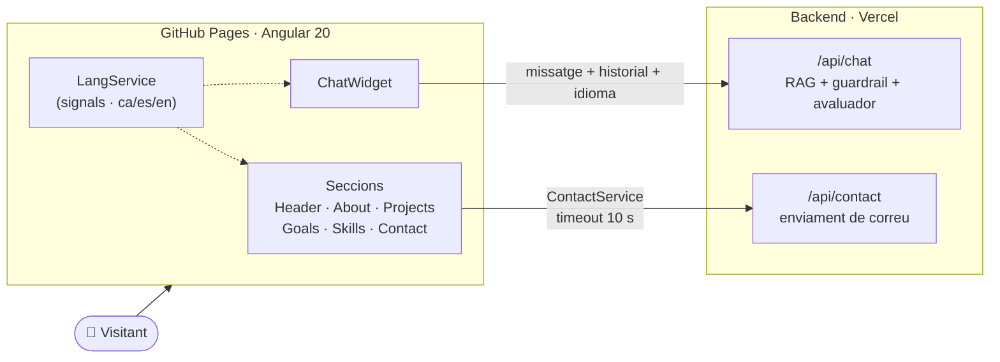

<div align="center">


# Jorge Perigüell Rubio · Portfoli

**Backend i IA aplicada · documentació i patrimoni**

*Huit anys catalogant arxius històrics. Ara construïsc programari que sap quan una dada no és fiable.*

[](https://jorgepr91.github.io/Porfolio_v.1/)
[](https://github.com/JorgePR91/Porfolio_v.1/actions/workflows/deploy.yml)
[](porfolio-20.1.5-app/LICENSE)


[Castellano](README.md) · **Valencià** · [English](README.en.md)

</div>

---

## ✦ Què és

El meu portfoli professional: una SPA en **Angular 20** que presenta qui sóc, els meus projectes, la meua trajectòria i les meues habilitats, en **tres idiomes**. No és una web estàtica qualsevol: inclou un **xatbot RAG en producció** que respon preguntes sobre el meu perfil sense inventar-se res, i un **formulari de contacte** connectat a un backend propi.

L'estètica naix del meu bagatge: graduat en Història, màster en Gestió Cultural i quasi huit anys a l'Arxiu Municipal de Xàtiva. Per això la paleta imita la **tinta carmesí i l'or de manuscrit il·luminat sobre pergamí fosc**, amb tipografia serif d'aire editorial.

<div align="center">

| Pergamí fosc | Tinta carmesí | Or de manuscrit | Tinta sobre pergamí |
| :---: | :---: | :---: | :---: |
|  |  |  |  |

**Fraunces** (títols) · **Space Grotesk** (text) · **JetBrains Mono** (codi)

</div>

---

## ✦ El més destacat

<table>
<tr>
<td width="50%" valign="top">

### 🤖 Xatbot sobre el meu perfil
Giny de xat que consulta un backend RAG (Python + FastAPI) desplegat a Vercel. Envia l'historial i l'idioma actiu, així que **respon en valencià, castellà o anglés**. Al servidor, un *guardrail* filtra abusos i *prompt injection*, un avaluador revisa cada resposta i un llindar de similitud descarta el context irrellevant.

→ [portfolio-rag-chatbot](https://github.com/JorgePR91/portfolio-rag-chatbot)

</td>
<td width="50%" valign="top">

### 🌐 i18n trilingüe
Valencià, castellà i anglés amb detecció automàtica: al navegador llig `localStorage` i `navigator.language`; al servidor, la capçalera `Accept-Language`. La preferència es guarda entre visites. Traduccions tipades en TypeScript i un `LangService` basat en **signals**.

</td>
</tr>
<tr>
<td width="50%" valign="top">

### ⚡ Angular modern
Components *standalone*, **detecció de canvis zoneless**, signals, `effect()`, `viewChild()`, el nou control de flux (`@for`), `HttpClient` amb `fetch` i hidratació del client amb *event replay*. Paquet inicial de **~95 kB** transferits.

</td>
<td width="50%" valign="top">

### ♿ Cura en els detalls
Focus gestionat en obrir i tancar el xat, tancament amb `Esc`, bloqueig del desplaçament compatible amb iOS Safari, ajust al teclat virtual amb `visualViewport`, respecte per `prefers-reduced-motion` i navegació per seccions amb *scroll-snap*.

</td>
</tr>
<tr>
<td width="50%" valign="top">

### 🔒 Seguretat al client
Content-Security-Policy restrictiva (només es connecta amb el backend propi), `X-Frame-Options: DENY`, `Referrer-Policy` i `Permissions-Policy` que desactiva càmera, micròfon i geolocalització.

</td>
<td width="50%" valign="top">

### 🚀 CI/CD sense intervenció
Cada *push* a `main` construïx i publica a **GitHub Pages** amb GitHub Actions. Un script `postbuild` copia `index.html` a `404.html` perquè les rutes de la SPA funcionen en un allotjament estàtic.

</td>
</tr>
</table>

---

## ✦ Arquitectura



---

## ✦ Projectes que mostra

| | Projecte | Stack |
| :---: | --- | --- |
| ⭐ | **[Portfolio Contact & Chatbot](https://github.com/JorgePR91/portfolio-rag-chatbot)**: xatbot RAG trilingüe en producció en aquesta mateixa web | Python · FastAPI · RAG · OpenAI · Upstash |
| 🧹 | **[PreForm](https://github.com/JorgePR91/PreForm)**: utilitat d'escriptori per a escanejar programes, netejar fitxers brossa i ordenar el sistema de fitxers | Electron · JavaScript |
| 🧬 | **[El Joc de la Vida](https://jdlv-vanilla.vercel.app/)**: nascut en Java per a DAW, migrat a Vanilla JS i publicat com a servei web | JavaScript |
| 🧭 | **[Onboarding-Program](https://github.com/JorgePR91/onboard-program-skill-)**: skill que genera un recorregut pedagògic per qualsevol repositori | Claude Skill |

---

## ✦ Estructura

```text
Porfolio_v.1/
├── .github/workflows/deploy.yml     # CI/CD → GitHub Pages
└── porfolio-20.1.5-app/
    ├── scripts/postbuild.js         # 404.html per a l'encaminament de la SPA
    └── src/
        ├── app/
        │   ├── nav/ header/ about-me/ projects/
        │   ├── goals/ skills/ contact/ footer/
        │   ├── chat/                # giny del xatbot
        │   ├── button-up/ button-local-link/
        │   ├── services/            # chat, chat-ui, contact, projects
        │   └── i18n/                # ca.ts · es.ts · en.ts · LangService · pipe
        ├── environments/            # URL del backend
        ├── assets/
        └── styles.scss              # tokens de disseny globals
```

---

## ✦ Executar en local

**Requisits:** Node.js 20+ i npm.

```bash
git clone https://github.com/JorgePR91/Porfolio_v.1.git
cd Porfolio_v.1/porfolio-20.1.5-app
npm install
npm start            # → http://localhost:4200/Porfolio_v.1/
```

| Ordre | Què fa |
| --- | --- |
| `npm start` | Servidor de desenvolupament amb recàrrega en calent |
| `npm run build` | Build de producció a `dist/` (i executa `postbuild`) |
| `npm run watch` | Build continu en mode desenvolupament |
| `npm test` | Proves unitàries amb Karma + Jasmine |

> [!NOTE]
> El xat i el formulari apunten al backend desplegat a Vercel (`src/environments/`). Per a usar-ne un de local, canvia `apiUrl` i `chatApiUrl` i afig el seu origen a `connect-src` en la CSP de `src/index.html`.

---

## ✦ Sobre mi

Sóc de **Xàtiva (València)** i m'estic especialitzant en **backend i IA aplicada**. Aporte una cosa poc habitual en un programador: quasi huit anys com a gestor documental (catalogació ISAD(G), digitalització, documentació històrica). Sé quines metadades importen, quins errors són greus i quan l'eixida d'un model no és fiable.

**Stack:** Java · Spring Boot · Python · FastAPI · Docker · PostgreSQL · Angular

<div align="center">

[](https://jorgepr91.github.io/Porfolio_v.1/)
[](https://github.com/JorgePR91)

<sub>❧ Fet amb Angular, café i ofici d'arxiver · MIT © 2025 Jorge Perigüell Rubio ❧</sub>

</div>