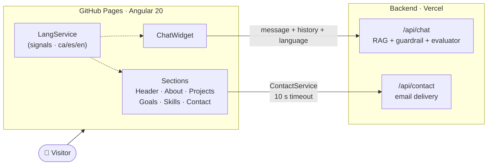

<div align="center">


# Jorge Perigüell Rubio · Portfolio

**Backend & applied AI · documentation and heritage**

*Eight years cataloguing historical archives. Now I build software that knows when data can't be trusted.*

[](https://jorgepr91.github.io/Porfolio_v.1/)
[](https://github.com/JorgePR91/Porfolio_v.1/actions/workflows/deploy.yml)
[](porfolio-20.1.5-app/LICENSE)


[Castellano](README.md) · [Valencià](README.ca.md) · **English**

</div>

---

## ✦ What it is

My professional portfolio: an **Angular 20** SPA that presents who I am, my projects, my background and my skills, in **three languages**. It's not just a static page: it includes a **RAG chatbot in production** that answers questions about my profile without making anything up, and a **contact form** wired to my own backend.

The look comes from my background: a degree in History, a master's in Cultural Management and almost eight years at the Municipal Archive of Xàtiva. That's why the palette imitates **crimson ink and illuminated-manuscript gold on dark parchment**, with editorial-style serif type.

<div align="center">

| Dark parchment | Crimson ink | Manuscript gold | Ink on parchment |
| :---: | :---: | :---: | :---: |
|  |  |  |  |

**Fraunces** (headings) · **Space Grotesk** (body) · **JetBrains Mono** (code)

</div>

---

## ✦ Highlights

<table>
<tr>
<td width="50%" valign="top">

### 🤖 A chatbot about me
A chat widget that queries a RAG backend (Python + FastAPI) deployed on Vercel. It sends the conversation history and the active language, so it **answers in Valencian, Spanish or English**. Server-side, a guardrail filters abuse and prompt injection, an evaluator checks every answer, and a similarity threshold discards irrelevant context.

→ [portfolio-rag-chatbot](https://github.com/JorgePR91/portfolio-rag-chatbot)

</td>
<td width="50%" valign="top">

### 🌐 Trilingual i18n
Valencian, Spanish and English with automatic detection: in the browser it reads `localStorage` and `navigator.language`; on the server, the `Accept-Language` header. The choice is remembered between visits. Typed TypeScript translations and a **signal**-based `LangService`.

</td>
</tr>
<tr>
<td width="50%" valign="top">

### ⚡ Modern Angular
Standalone components, **zoneless change detection**, signals, `effect()`, `viewChild()`, the new control flow (`@for`), `HttpClient` with `fetch`, and client hydration with event replay. Initial bundle of **~95 kB** transferred.

</td>
<td width="50%" valign="top">

### ♿ Attention to detail
Managed focus when the chat opens and closes, `Esc` to close, scroll lock that works on iOS Safari, virtual-keyboard handling through `visualViewport`, `prefers-reduced-motion` support, and section navigation with scroll-snap.

</td>
</tr>
<tr>
<td width="50%" valign="top">

### 🔒 Client-side security
A strict Content-Security-Policy (it only connects to my own backend), `X-Frame-Options: DENY`, `Referrer-Policy`, and a `Permissions-Policy` that disables camera, microphone and geolocation.

</td>
<td width="50%" valign="top">

### 🚀 Hands-off CI/CD
Every push to `main` builds and publishes to **GitHub Pages** with GitHub Actions. A `postbuild` script copies `index.html` to `404.html` so SPA routes work on static hosting.

</td>
</tr>
</table>

---

## ✦ Architecture



---

## ✦ Featured projects

| | Project | Stack |
| :---: | --- | --- |
| ⭐ | **[Portfolio Contact & Chatbot](https://github.com/JorgePR91/portfolio-rag-chatbot)**: trilingual RAG chatbot running in production on this very site | Python · FastAPI · RAG · OpenAI · Upstash |
| 🧹 | **[PreForm](https://github.com/JorgePR91/PreForm)**: desktop utility to scan installed programs, clean junk files and organise your file system | Electron · JavaScript |
| 🧬 | **[Game of Life](https://jdlv-vanilla.vercel.app/)**: first written in Java for a DAW course, then ported to Vanilla JS and published as a web service | JavaScript |
| 🧭 | **[Onboarding-Program](https://github.com/JorgePR91/onboard-program-skill-)**: a skill that builds a guided learning path through any repository | Claude Skill |

---

## ✦ Structure

```text
Porfolio_v.1/
├── .github/workflows/deploy.yml     # CI/CD → GitHub Pages
└── porfolio-20.1.5-app/
    ├── scripts/postbuild.js         # 404.html for SPA routing
    └── src/
        ├── app/
        │   ├── nav/ header/ about-me/ projects/
        │   ├── goals/ skills/ contact/ footer/
        │   ├── chat/                # chatbot widget
        │   ├── button-up/ button-local-link/
        │   ├── services/            # chat, chat-ui, contact, projects
        │   └── i18n/                # ca.ts · es.ts · en.ts · LangService · pipe
        ├── environments/            # backend URLs
        ├── assets/
        └── styles.scss              # global design tokens
```

---

## ✦ Run locally

**Requirements:** Node.js 20+ and npm.

```bash
git clone https://github.com/JorgePR91/Porfolio_v.1.git
cd Porfolio_v.1/porfolio-20.1.5-app
npm install
npm start            # → http://localhost:4200/Porfolio_v.1/
```

| Command | What it does |
| --- | --- |
| `npm start` | Development server with hot reload |
| `npm run build` | Production build into `dist/` (also runs `postbuild`) |
| `npm run watch` | Continuous build in development mode |
| `npm test` | Unit tests with Karma + Jasmine |

> [!NOTE]
> The chat and contact form point to the backend deployed on Vercel (`src/environments/`). To use a local one, change `apiUrl` and `chatApiUrl` and add its origin to `connect-src` in the CSP in `src/index.html`.

---

## ✦ About me

I'm from **Xàtiva (Valencia, Spain)** and I'm specialising in **backend and applied AI**. I bring something unusual for a developer: almost eight years as a records manager (ISAD(G) cataloguing, digitisation, historical documents). I know which metadata matter, which errors are serious, and when a model's output can't be trusted.

**Stack:** Java · Spring Boot · Python · FastAPI · Docker · PostgreSQL · Angular

<div align="center">

[](https://jorgepr91.github.io/Porfolio_v.1/)
[](https://github.com/JorgePR91)

<sub>❧ Made with Angular, coffee and an archivist's craft · MIT © 2025 Jorge Perigüell Rubio ❧</sub>

</div>