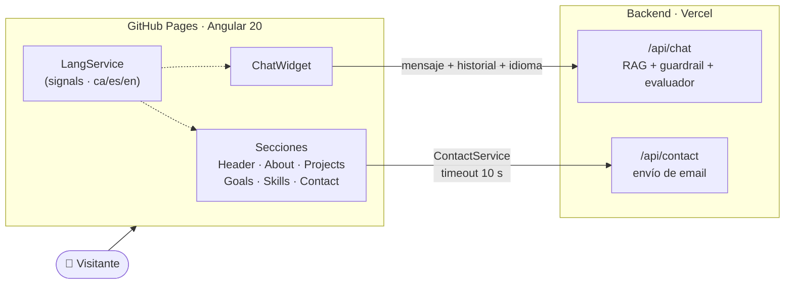

<div align="center">


# Jorge Perigüell Rubio · Portfolio

**Backend e IA aplicada · documentación y patrimonio**

*Ocho años catalogando archivos históricos. Ahora construyo software que sabe cuándo un dato no es fiable.*

[](https://jorgepr91.github.io/Porfolio_v.1/)
[](https://github.com/JorgePR91/Porfolio_v.1/actions/workflows/deploy.yml)
[](porfolio-20.1.5-app/LICENSE)


🇪🇸 Castellano ·  Valencià · 🇬🇧 English

</div>

---

## ✦ Qué es

Mi portfolio profesional: una SPA en **Angular 20** que presenta quién soy, mis proyectos, mi trayectoria y mis habilidades, en **tres idiomas**. No es una web estática al uso: incluye un **chatbot RAG en producción** que responde preguntas sobre mi perfil sin inventarse nada, y un **formulario de contacto** conectado a un backend propio.

La estética nace de mi bagaje: graduado en Historia, máster en Gestión Cultural y casi ocho años en el Arxiu Municipal de Xàtiva. Por eso la paleta imita **tinta carmesí y oro de manuscrito iluminado sobre pergamino oscuro**, con tipografía serif de aire editorial.

<div align="center">

| Pergamino oscuro | Tinta carmesí | Oro de manuscrito | Tinta sobre pergamino |
| :---: | :---: | :---: | :---: |
|  |  |  |  |

**Fraunces** (títulos) · **Space Grotesk** (texto) · **JetBrains Mono** (código)

</div>

---

## ✦ Lo más destacado

<table>
<tr>
<td width="50%" valign="top">

### 🤖 Chatbot sobre mi perfil
Widget de chat que consulta un backend RAG (Python + FastAPI) desplegado en Vercel. Envía el historial y el idioma activo, así que **responde en castellano, valenciano o inglés**. En el servidor, un guardrail filtra abusos y *prompt injection*, un evaluador revisa cada respuesta y un umbral de similitud descarta contexto irrelevante.

→ [portfolio-rag-chatbot](https://github.com/JorgePR91/portfolio-rag-chatbot)

</td>
<td width="50%" valign="top">

### 🌐 i18n trilingüe
Valencià, castellano e inglés con detección automática: en el navegador lee `localStorage` y `navigator.language`; en el servidor, la cabecera `Accept-Language`. La preferencia se guarda entre visitas. Traducciones tipadas en TypeScript y un `LangService` basado en **signals**.

</td>
</tr>
<tr>
<td width="50%" valign="top">

### ⚡ Angular moderno
Componentes *standalone*, **detección de cambios zoneless**, signals, `effect()`, `viewChild()`, nuevo control flow (`@for`), `HttpClient` con `fetch` e hidratación del cliente con *event replay*. Bundle inicial de **~95 kB** transferidos.

</td>
<td width="50%" valign="top">

### ♿ Cuidado en los detalles
Foco gestionado al abrir y cerrar el chat, cierre con `Esc`, bloqueo de scroll compatible con iOS Safari, ajuste al teclado virtual vía `visualViewport`, `prefers-reduced-motion` respetado y navegación por secciones con *scroll-snap*.

</td>
</tr>
<tr>
<td width="50%" valign="top">

### 🔒 Seguridad en el cliente
Content-Security-Policy restrictiva (solo conecta con el backend propio), `X-Frame-Options: DENY`, `Referrer-Policy` y `Permissions-Policy` que desactiva cámara, micrófono y geolocalización.

</td>
<td width="50%" valign="top">

### 🚀 CI/CD sin intervención
Cada *push* a `main` construye y publica en **GitHub Pages** con GitHub Actions. Un script `postbuild` copia `index.html` a `404.html` para que las rutas de la SPA funcionen en un hosting estático.

</td>
</tr>
</table>

---

## ✦ Arquitectura



---

## ✦ Proyectos que muestra

| | Proyecto | Stack |
| :---: | --- | --- |
| ⭐ | **[Portfolio Contact & Chatbot](https://github.com/JorgePR91/portfolio-rag-chatbot)** — chatbot RAG trilingüe en producción en esta misma web | Python · FastAPI · RAG · OpenAI · Upstash |
| 🧹 | **[PreForm](https://github.com/JorgePR91/PreForm)** — utilidad de escritorio para escanear programas, limpiar basura y ordenar el sistema de archivos | Electron · JavaScript |
| 🧬 | **[El Juego de la Vida](https://jdlv-vanilla.vercel.app/)** — nacido en Java para DAW, migrado a Vanilla JS y publicado como servicio web | JavaScript |
| 🧭 | **[Onboarding-Program](https://github.com/JorgePR91/onboard-program-skill-)** — skill que genera un recorrido pedagógico por cualquier repositorio | Claude Skill |

---

## ✦ Estructura

```text
Porfolio_v.1/
├── .github/workflows/deploy.yml     # CI/CD → GitHub Pages
└── porfolio-20.1.5-app/
    ├── scripts/postbuild.js         # 404.html para el enrutado de la SPA
    └── src/
        ├── app/
        │   ├── nav/ header/ about-me/ projects/
        │   ├── goals/ skills/ contact/ footer/
        │   ├── chat/                # widget del chatbot
        │   ├── button-up/ button-local-link/
        │   ├── services/            # chat, chat-ui, contact, projects
        │   └── i18n/                # ca.ts · es.ts · en.ts · LangService · pipe
        ├── environments/            # URLs del backend
        ├── assets/
        └── styles.scss              # tokens de diseño globales
```

---

## ✦ Ejecutar en local

**Requisitos:** Node.js 20+ y npm.

```bash
git clone https://github.com/JorgePR91/Porfolio_v.1.git
cd Porfolio_v.1/porfolio-20.1.5-app
npm install
npm start            # → http://localhost:4200/Porfolio_v.1/
```

| Comando | Qué hace |
| --- | --- |
| `npm start` | Servidor de desarrollo con recarga en caliente |
| `npm run build` | Build de producción en `dist/` (y ejecuta `postbuild`) |
| `npm run watch` | Build continuo en modo desarrollo |
| `npm test` | Tests unitarios con Karma + Jasmine |

> [!NOTE]
> El chat y el formulario apuntan al backend desplegado en Vercel (`src/environments/`). Para usar uno local, cambia `apiUrl` y `chatApiUrl` y añade su origen a `connect-src` en la CSP de `src/index.html`.

---

## ✦ Sobre mí

Soy de **Xàtiva (Valencia)** y me estoy especializando en **backend e IA aplicada**. Aporto algo poco habitual en un programador: casi ocho años como gestor documental (catalogación ISAD(G), digitalización, documentación histórica). Sé qué metadatos importan, qué errores son graves y cuándo la salida de un modelo no es fiable.

**Stack:** Java · Spring Boot · Python · FastAPI · Docker · PostgreSQL · Angular

<div align="center">

[](https://jorgepr91.github.io/Porfolio_v.1/)
[](https://github.com/JorgePR91)

<sub>❧ Hecho con Angular, café y oficio de archivero · MIT © 2025 Jorge Perigüell Rubio ❧</sub>

</div>